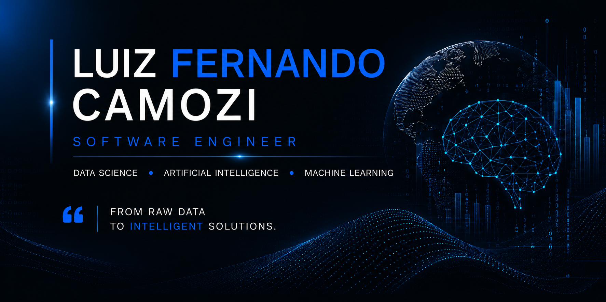
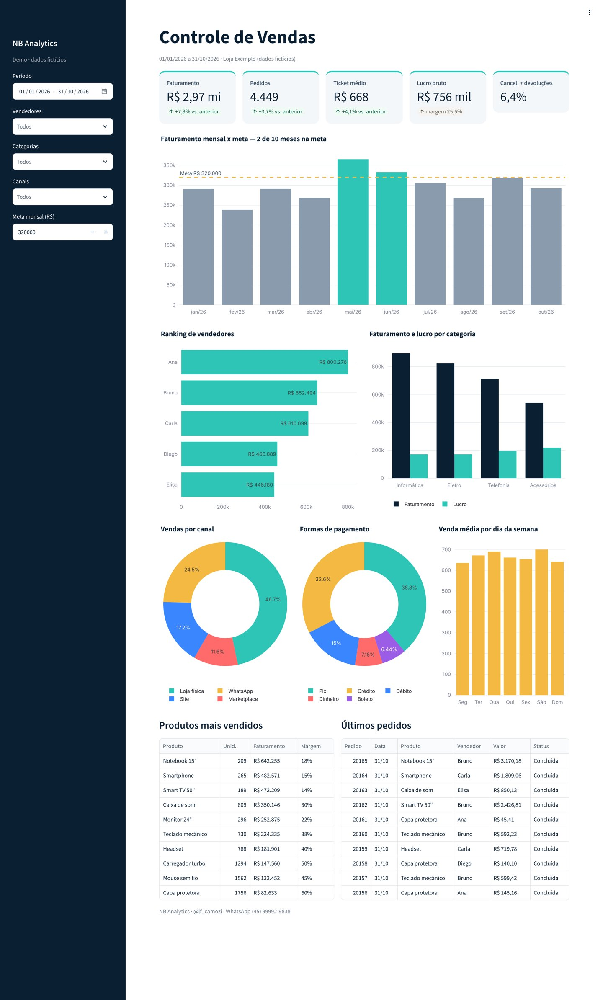

  

  
  
  

## Hi, I'm Luiz Fernando 👋

Software Engineer turning business data into dashboards and decisions.

By day I implement and customize **ERP systems for the tourism industry** — back-office, ticketing and e-commerce — so I know how real companies run and where their data gets stuck. I'm now combining that with **data science and AI** to build analytics products for small and mid-sized businesses.

- 🏗️ Building **NB Analytics** — automated dashboards and data analysis for SMBs
- 📊 Focus: data pipelines in Python, PostgreSQL and interactive dashboards
- 🌎 Open to international projects and remote opportunities

## 🚀 Featured projects

### Sales Control Dashboard · NB Analytics
Automated sales dashboard with revenue vs. target, sales-rep ranking, category margins, channels, payment methods and product performance — filterable by period, rep, category and channel.

`Python` `Streamlit` `Plotly` `pandas`

Demo built with synthetic data · code available on request.

### [Potencial de Honorários](https://luizcamozi.github.io/Potencial_honor-rios/)
Web page to estimate fee potential, published with GitHub Pages. · [Live](https://luizcamozi.github.io/Potencial_honor-rios/) · [Code](https://github.com/luizcamozi/Potencial_honor-rios)

## 🛠️ Tech stack

  

**Data & BI:** pandas · Plotly · Streamlit · SQL · ETL · ERP integrations

## 🎓 Education

- Software Engineering
- Systems Analysis and Development

## 🌱 Currently learning

Statistics · Machine Learning · Deep Learning · AI Agents · LLM applications

## 🎯 2026 goals

- Build a strong, real-world Data Science portfolio
- Grow into an AI Engineer role
- Work with international clients
- Contribute to open source
